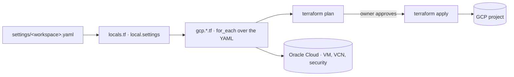

<h1 align="center">terraform-base</h1>

<p align="center">
  <em>A YAML-driven Terraform template to bootstrap the infrastructure of a new project on
  Google Cloud (and optionally Oracle Cloud). Describe the project in one YAML file,
  let the root modules turn it into resources, click nothing in a console.</em>
</p>

<p align="center">
  
</p>

<p align="center">
  
  
  
  
</p>

## The pattern

One `gcp.<type>.tf` file per resource type reads `local.settings`, and `local.settings` is
just `settings/default.yaml` merged with `settings/<workspace>.yaml`. Every section is
optional: a workspace without a `database:` block creates no Cloud SQL, a workspace without
`lb:` creates no load balancer. Adding a Cloud Run service, a bucket, a DNS record or an
IAM binding is an edit to a YAML file, not new Terraform.

The Terraform **workspace is the project**. One YAML per workspace, one GCP project per
workspace, one shared state bucket with a prefix per workspace.



## What you get

| Section in the YAML | Resources it creates |
|---|---|
| `app.service` | Cloud Run service, its service account, Artifact Registry repo, Cloud Build trigger, NEG and LB backend, secrets, IAM |
| `app.job` | Cloud Run job, service account, invokers |
| `scheduler` | Cloud Scheduler jobs targeting Cloud Run jobs |
| `cloudbuild` | Standalone Cloud Build triggers (libraries, base images) |
| `bucket` | GCS buckets with IAM, lifecycle, CORS, website |
| `network` | VPC, subnet, serverless connector, Cloud NAT, private service access |
| `lb`, `iap`, `monitoring` | Global HTTPS LB, managed SSL, IAP, Cloud Armor, alert policies |
| `database`, `redis`, `firestore` | Cloud SQL (Postgres), Memorystore, Firestore databases and indexes |
| `secrets`, `external_secret_access` | Secret Manager containers and accessors |
| `pubsub`, `cloud_tasks` | Topics, subscriptions, queues |
| `dns` | Managed zones and records |
| `budget` | Billing budget with optional automatic billing shutdown |
| `compute_instances`, `compute_nats` | VMs and NAT for the default network (IAP SSH firewall rules are always created) |
| `elastic`, `binary_authorization`, `repo_providers` | PSC to Elastic Cloud, Binary Authorization, GitHub/Bitbucket connections |
| `oracle` | OCI instances, VCN and security lists |

`settings/example.yaml` documents every key. `docs/CONFIGURATION_GUIDE.md` is the short version.

## Bootstrapping a new project

1. **Use this template.** Create a repository from it (GitHub: "Use this template") or clone it.
2. **Create the GCP project** and a bucket for remote state, by hand or with gcloud:
   ```bash
   gcloud projects create my-project --name="My Project"
   gcloud storage buckets create gs://my-project-tfstate --project=my-project --location=europe-west1
   ```
3. **Point the backend at it** in `versions.tf` (`bucket = "my-project-tfstate"`).
4. **Set the shared defaults** in `settings/default.yaml`: region, `client.name` (the short prefix every resource name starts with), the enabled APIs.
5. **Create the workspace file** by copying the sections you need from `settings/example.yaml` into `settings/<workspace>.yaml`. `project.id`, `project.name` and `project.number` are mandatory.
6. **Plan and apply:**
   ```bash
   terraform init
   terraform workspace new my-workspace
   terraform plan -detailed-exitcode   # exit 0 = converged, 2 = changes pending
   terraform apply                     # read the plan first, all of it
   ```

The first apply enables the APIs listed under `active-apis` and creates the security
baseline, the Cloud Build service account and its artifacts bucket. Everything else depends
on which sections your YAML declares.

### Oracle Cloud

`oracle.*.tf` are inert until the YAML has an `oracle:` section. The OCI provider reads
`~/.oci/config` (profile `DEFAULT`); set that up with the OCI CLI before planning a
workspace that uses it.

## Layout

| Path | What |
|---|---|
| `settings/default.yaml` | Shared defaults for every workspace |
| `settings/example.yaml` | Commented reference of every supported key |
| `settings/<workspace>.yaml` | One file per project. This is what you edit day to day |
| `gcp.<type>.tf` | One root file per resource type, each a `for_each` over its YAML section |
| `oracle.*.tf` | The OCI side |
| `locals.tf` · `providers.tf` · `versions.tf` | YAML loading, provider config and pins, state backend |
| `modules/` | 9 vendored, version-stamped modules |
| `cloudbuild_files/` | The single shared Cloud Build pipeline (see `docs/cloudbuild-pipeline.md`) |
| `cloud_function_source/` | The stop-billing Cloud Function |
| `bin/` | Helpers: render a service's effective pipeline, audit registry cleanup |
| `docs/` | Structure, configuration, pipeline, tag patterns, billing control |

## Rules worth keeping

- **No console edits.** Anything created by hand is drift. If it must exist, it goes in the
  YAML and gets applied, or it gets imported.
- **`terraform apply` is an announced step.** A plan that deletes or replaces anything
  stateful (SQL, Firestore, buckets) is a conversation, not a keystroke.
- **Never `-target`.** A targeted plan reports only on its targets, so what it omits is
  invisible, including the fact that it was omitted. A full plan is the only thing that
  tells you the workspace matches the code.
- **Secrets are referenced, not stored.** Terraform creates the container and a
  placeholder version; the payload goes in with `gcloud secrets versions add`.
- **A destroy that reports success is not proof.** Some resources (Firestore, notably)
  survive a `destroyed` line. Verify with `gcloud` afterwards.

## License

MIT. See `LICENSE`.
