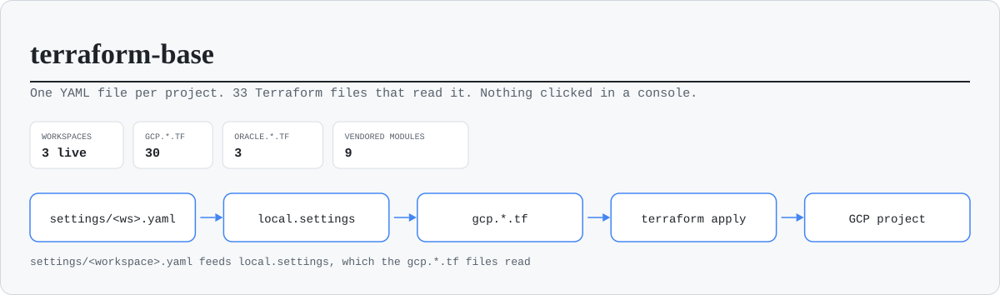
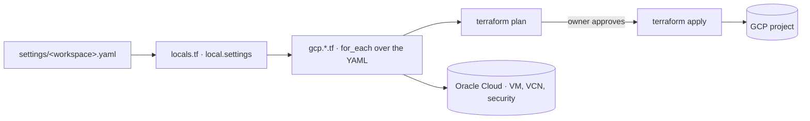

<h1 align="center">terraform-base</h1>

<p align="center">
  <em>A Terraform template for starting new projects on Google Cloud, with optional Oracle
  Cloud support. You describe each environment in a YAML file and Terraform builds it.</em>
</p>

<p align="center">
  
</p>

<p align="center">
  
  
  
  
</p>

## How it works

`locals.tf` loads `settings/default.yaml`, merges `settings/<workspace>.yaml` on top of it,
and exposes the result as `local.settings`. Each `gcp.<type>.tf` file reads its own section
of that object and loops over it. If a section is missing, that file creates nothing. A
workspace with no `database:` block gets no Cloud SQL, and one with no `lb:` gets no load
balancer.

In practice, adding a Cloud Run service, a bucket, a DNS record or an IAM binding means
editing YAML. You only write new Terraform when you need a resource type the template
doesn't cover yet.

Each Terraform workspace maps to one GCP project and one YAML file. All workspaces share a
single state bucket, and Terraform gives each one its own prefix inside it.



## What each section creates

| Section in the YAML | Resources it creates |
|---|---|
| `app.service` | Cloud Run service, its service account, Artifact Registry repo, Cloud Build trigger, NEG and LB backend, secrets, IAM |
| `app.job` | Cloud Run job, service account, invokers |
| `scheduler` | Cloud Scheduler jobs targeting Cloud Run jobs |
| `cloudbuild` | Standalone Cloud Build triggers (libraries, base images) |
| `bucket` | GCS buckets with IAM, lifecycle, CORS, website |
| `network` | VPC, subnet, serverless connector, Cloud NAT, private service access |
| `lb`, `iap`, `monitoring` | Global HTTPS LB, managed SSL, IAP, Cloud Armor, alert policies |
| `database`, `redis`, `firestore` | Cloud SQL (Postgres), Memorystore, Firestore databases and indexes |
| `secrets`, `external_secret_access` | Secret Manager containers and accessors |
| `pubsub`, `cloud_tasks` | Topics, subscriptions, queues |
| `dns` | Managed zones and records |
| `budget` | Billing budget with optional automatic billing shutdown |
| `compute_instances`, `compute_nats` | VMs and NAT for the default network (IAP SSH firewall rules are always created) |
| `elastic_psc`, `binary_authorization`, `repo_providers` | PSC to Elastic Cloud, Binary Authorization, GitHub/Bitbucket connections |
| `oracle` | OCI instances, VCN and security lists |

Every key is documented in `settings/example.yaml`. `docs/CONFIGURATION_GUIDE.md` covers
the common ones if you don't want to read 900 lines of comments.

## Starting a new project

1. Create a repository from this template with GitHub's "Use this template" button, or
   just clone it.
2. Create the GCP projects and a bucket for remote state. `AGENTS.md` describes the folder
   and naming layout to use (one folder and one project per environment, plus a shared ops
   project for state). For a single project, the minimum is:
   ```bash
   gcloud projects create my-project --name="My Project"
   gcloud storage buckets create gs://my-project-tfstate --project=my-project --location=europe-west1
   ```
3. Copy `backend.hcl.example` to `backend.hcl` (gitignored) and set `bucket`, plus
   `prefix` if several stacks share the bucket. `versions.tf` keeps an empty
   `backend "gcs" {}`, so no tracked file holds the bucket name.
4. Edit `settings/default.yaml`. Set the region, the base APIs, and `client.name`, which
   is the short prefix every resource name starts with.
5. Start from `settings/pre.yaml` or `settings/pro.yaml` (see `docs/ENVIRONMENTS.md`),
   or copy the sections you need from `settings/example.yaml`. Replace the
   placeholder project id, billing account and email. The only required keys are
   `project.id`, `project.name`, `project.number` and `security.alerts_email`.
6. Plan and apply:
   ```bash
   terraform init -backend-config=backend.hcl
   terraform workspace new my-workspace
   terraform plan -detailed-exitcode   # exit 0 = nothing to change, 2 = changes pending
   terraform apply
   ```

The first apply turns on the base APIs listed under `active-apis`, plus the APIs of
each feature the workspace uses (`docs/CONFIGURATION_GUIDE.md`, "Enabled APIs"), and
creates the security baseline. What happens after that depends on which sections your YAML has: the Cloud
Build service account and its artifacts bucket, for example, come with the first build.

After an apply, `terraform output` prints what you need next, from `outputs.tf`:
`load_balancer_ip` and `load_balancer_domains` (for the DNS A records),
`cloud_run_service_urls`, `cloud_sql_connection_names`,
`artifact_registry_service_urls` and `artifact_registry_standalone_urls`,
`wif_providers` and `wif_service_accounts` (for the CI auth step) and
`audit_archive_bucket`. A feature the workspace does not have gives an empty
map or null. No output carries a password or other secret.

### Oracle Cloud

The `oracle.*.tf` files do nothing until the YAML has an `oracle:` section. The OCI
provider reads `~/.oci/config` with the `DEFAULT` profile, so set that up with the OCI CLI
before you plan a workspace that uses it.

## Layout

| Path | What |
|---|---|
| `settings/default.yaml` | Defaults shared by every workspace |
| `settings/example.yaml` | Commented reference of every supported key |
| `settings/<workspace>.yaml` | One file per project, and the file you'll edit most |
| `gcp.<type>.tf` | One root file per resource type, each a `for_each` over its YAML section |
| `oracle.*.tf` | The OCI side |
| `locals.tf` · `providers.tf` · `versions.tf` | YAML loading, provider config and pins, state backend (partial) |
| `backend.hcl.example` | Template of the gitignored `backend.hcl`: state bucket and prefix |
| `outputs.tf` | Root outputs: load balancer IP and domains, service URLs, SQL connection names, registries, federation |
| `modules/` | 9 vendored modules, with the version in the directory name |
| `cloudbuild_files/` | The one Cloud Build pipeline every service shares (see `docs/cloudbuild-pipeline.md`) |
| `cloud_function_source/` | The Cloud Function that disables billing when the budget runs out |
| `bin/` | Scripts to render a service's effective pipeline and audit registry cleanup |
| `docs/` | Structure, configuration, pipeline, tag patterns, billing control |

## Rules I'd keep

Don't create things in the console. Anything made by hand is drift that the next plan
can't see. If it needs to exist, add it to the YAML and apply, or import it.

Read the whole plan before you apply it. If it deletes or replaces something that holds
data, like a Cloud SQL instance, a Firestore database or a bucket, stop and check with
whoever owns that data first.

Avoid `-target`. A targeted plan only reports on its targets, so you can't see what it
skipped, or even that it skipped anything. A full plan is the only way to know the
workspace matches the code.

Keep secret values out of Terraform. The template creates the secret and a placeholder
version, and you add the real value with `gcloud secrets versions add`.

Check that destroys actually happened. Firestore in particular can survive an apply that
says it was destroyed, so confirm with `gcloud` afterwards.

## Checks

Pull requests and pushes to `main` run `.github/workflows/terraform.yml`,
with no GCP login:

- `fmt`: `terraform fmt -check` on the root files and the tests (not the
  vendored modules).
- `test`: `terraform test` plans the default, dev and pro shapes with mock
  providers (`tests/*.tftest.hcl`): what each one must create and must not.
- `validate`: `terraform validate` once per workspace, `default`, `dev`,
  `stg`, `pre` and `pro`, each with `TF_WORKSPACE` set, so a broken settings
  file fails its own job. `default` runs `terraform init -backend=false`; the
  others write a `backend_override.tf` with a local backend first.
- `scripts`: `python3 bin/cloudbuild-render-test.py` (needs PyYAML),
  `python3 bin/validate-settings.py` (every `settings/*.yaml` against
  `schemas/settings.schema.json`, with jsonschema and again with its built-in
  validator) and `python3 bin/audit-terraform.py --fail-on p0`, which fails
  while a p0 item in `docs/audit/BACKLOG.md` is still open.

A newer push to the same branch cancels the run it replaces.

## Production readiness backlog

`docs/audit/BACKLOG.md` is the list of work left before a public,
production-grade release, plus the platform features this template
deliberately leaves out (a VPC per service, a scanner that needs its own
instance, CMEK on every resource, and the rest of that list). Every item has a
check in `bin/audit-terraform.py`; refresh the file with
`python3 bin/audit-terraform.py --write`. How to take one item into a pull
request: `docs/audit/OPERATING.md`. Sessions that edit this repo should read
`AGENTS.md` first.

## License

MIT. See `LICENSE`.
